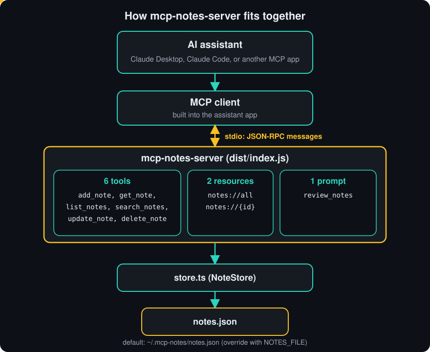
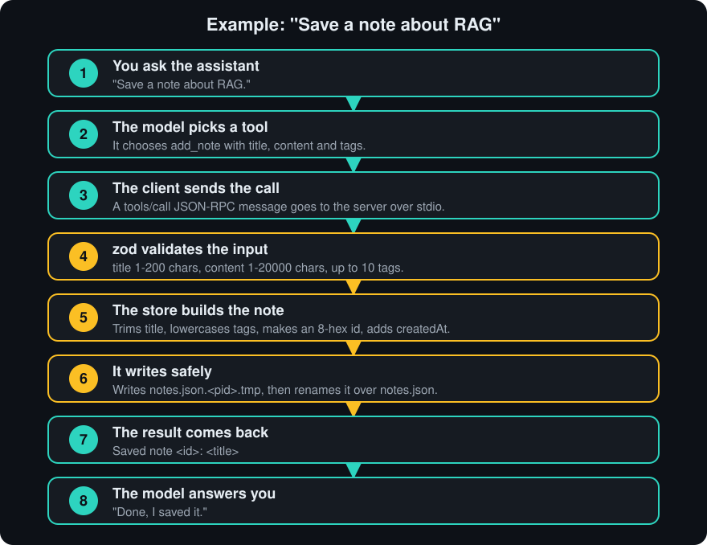
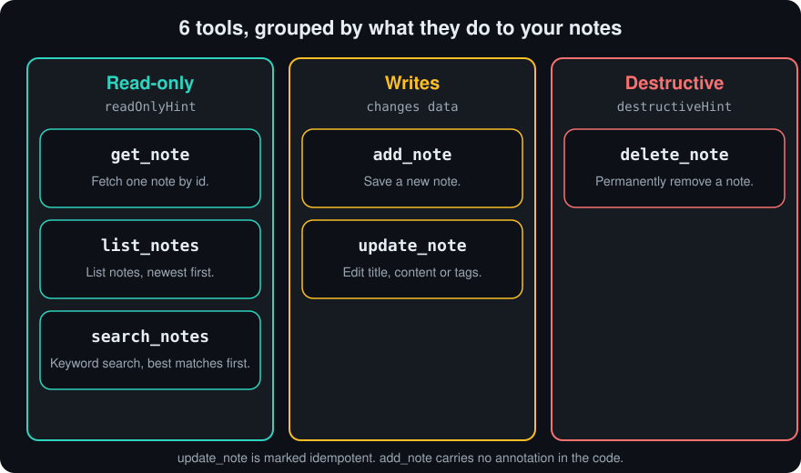
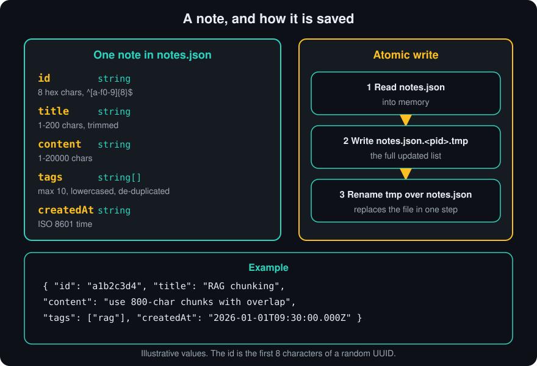
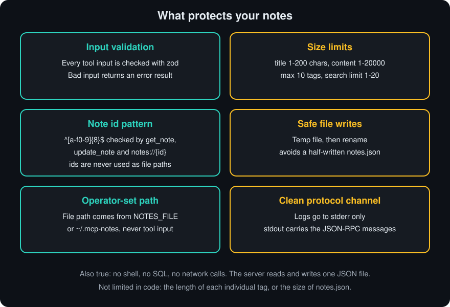

<div align="center">

# mcp-notes-server

[](https://m8ven.ai/mcp/techsaurabh-394-mcp-notes-server-1v0wwu?s=readme)

**Give your AI assistant a notebook it can write in, search and remember.**

A small, fully tested [Model Context Protocol](https://modelcontextprotocol.io) server in TypeScript: 6 tools, 2 resources and 1 prompt, backed by a single JSON file.

[](https://github.com/techsaurabh-394/mcp-notes-server/actions/workflows/ci.yml)
[](LICENSE)
[](package.json)
[](tsconfig.json)
[](https://modelcontextprotocol.io)
[](https://github.com/techsaurabh-394/mcp-notes-server/stargazers)
[](https://github.com/techsaurabh-394/mcp-notes-server/commits/main)

</div>

## What does this do? (30 seconds)

You run this small program next to your AI app (Claude Desktop, Claude Code, ...). The assistant gains tools to save, find, edit and delete notes, and the notes survive between chats because they live in a file on your computer.

```text
You:        Remember this: for RAG, use 800-char chunks with overlap. Tag it rag.
Assistant:  (calls add_note)  ->  Saved note b265a3ff: RAG chunking
Assistant:  Saved it as a note tagged "rag".

   ... days later, in a new chat ...

You:        What did I decide about chunk size?
Assistant:  (calls search_notes with "chunk")
            [b265a3ff] RAG chunking  #rag
            use 800-char chunks with overlap
Assistant:  You decided on 800-character chunks with overlap.
```

The ids and exact wording above come from a real run of the server; the assistant's own replies will vary.



## What is MCP?

The Model Context Protocol is an open standard that lets AI apps (like Claude) talk to outside programs in one uniform way, a bit like USB-C for AI. Instead of custom glue for every assistant, you write one *MCP server* that offers **tools** (actions the AI can run), **resources** (data it can read) and **prompts** (reusable templates), and any MCP client can discover and use them.

**Learn MCP step by step:** [ai-engineer-roadmap / 06-mcp](https://github.com/techsaurabh-394/ai-engineer-roadmap/tree/main/06-mcp)

## Table of contents

- [Quick start](#quick-start)
- [Connect it to your AI app](#connect-it-to-your-ai-app)
- [How a request flows](#how-a-request-flows)
- [Tools reference](#tools-reference)
- [Resources and prompt](#resources-and-prompt)
- [Where notes are stored](#where-notes-are-stored)
- [Security design](#security-design)
- [Troubleshooting](#troubleshooting)
- [Testing and development](#testing-and-development)
- [Project layout](#project-layout)
- [Roadmap](#roadmap-contributions-welcome)

## Quick start

### Option A: run from npm (no clone)

With Node.js 18 or newer:

```bash
npx -y mcp-notes-server
```

You should see `mcp-notes-server running on stdio` and then nothing else; the server is waiting for an MCP client. Press Ctrl+C to stop. To use it from an AI app, see [Connect it to your AI app](#connect-it-to-your-ai-app).

### Option B: build from source

You need **Node.js 18 or newer** (CI runs Node 22) and git.

```bash
git clone https://github.com/techsaurabh-394/mcp-notes-server.git
cd mcp-notes-server
npm install
npm run build      # compiles src/ to dist/
npm test           # optional: builds and runs the test suite
```

Check that the server starts:

```bash
node dist/index.js
```

You should see `mcp-notes-server running on stdio` and then nothing else. That is correct: the server is now waiting for an MCP client to talk to it. Press Ctrl+C to stop. You normally never run it by hand; your AI app starts it for you (next section).

Want to poke at it without an AI app? Use the MCP Inspector:

```bash
npx @modelcontextprotocol/inspector node dist/index.js
```

Open the printed URL to browse and call the tools, resources and prompt.

## Connect it to your AI app

**With npx (no clone):** Claude Code: `claude mcp add notes -- npx -y mcp-notes-server`. Claude Desktop: use `"command": "npx"` and `"args": ["-y", "mcp-notes-server"]` in the config below instead of the `node` lines.

**From a clone:** first find the **absolute path** to the built server. From inside the cloned folder:

```bash
echo "$(pwd)/dist/index.js"
```

Use that output wherever you see `/absolute/path/to/mcp-notes-server/dist/index.js` below. An absolute path starts at the root of your disk (for example `/Users/you/mcp-notes-server/dist/index.js`), because the AI app does not start in your project folder.

### Claude Desktop

Add this to `claude_desktop_config.json` (in Claude Desktop: Settings, Developer, Edit Config):

```json
{
  "mcpServers": {
    "notes": {
      "command": "node",
      "args": ["/absolute/path/to/mcp-notes-server/dist/index.js"],
      "env": { "NOTES_FILE": "/absolute/path/to/notes.json" }
    }
  }
}
```

`NOTES_FILE` is optional. Leave out the whole `env` line to use the default location. Fully quit and restart Claude Desktop, then try:

- "Save a note titled *RAG chunking* with the content *use 800-char chunks with overlap*, tag it rag."
- "Search my notes for chunking."
- "Change the tags on that note to rag and search."

### Claude Code

```bash
claude mcp add notes -- node /absolute/path/to/mcp-notes-server/dist/index.js
# optional: custom storage file
claude mcp add notes --env NOTES_FILE=/absolute/path/to/notes.json -- node /absolute/path/to/mcp-notes-server/dist/index.js
```

Run `claude mcp list` to confirm. Other MCP clients (Cursor, etc.) work the same way: point them at `node dist/index.js` over stdio.

## How a request flows



## Tools reference



| Tool | What it does | Hints |
|---|---|---|
| `add_note` | Save a note with title, content and optional tags | Writes |
| `get_note` | Fetch one note by id | Read-only |
| `list_notes` | List notes newest first, optionally by tag | Read-only |
| `search_notes` | Keyword search over titles, tags and bodies (title matches rank highest) | Read-only |
| `update_note` | Edit title, content and/or tags (tags replace existing ones) | Writes, idempotent |
| `delete_note` | Permanently delete a note by id | Destructive |

Problems (unknown id, malformed id, empty update, delete of a missing id) come back as results with `isError: true` and a clear message, not as crashes. The examples below show the text a tool returns.

### add_note

Save a new note. Returns the note id.

| Parameter | Type | Required | Limits |
|---|---|---|---|
| `title` | string | yes | 1 to 200 characters; trimmed before saving |
| `content` | string | yes | 1 to 20000 characters |
| `tags` | array of strings | no | at most 10; lowercased, trimmed, blanks and duplicates removed |

```json
{ "title": "RAG chunking", "content": "use 800-char chunks with overlap", "tags": ["RAG", "Search"] }
```
Result: `Saved note b265a3ff: RAG chunking` (tags are stored as `rag`, `search`)

### get_note

Fetch one note by id, with full content.

| Parameter | Type | Required | Limits |
|---|---|---|---|
| `id` | string | yes | must match `^[a-f0-9]{8}$` |

```json
{ "id": "b265a3ff" }
```
Result:
```text
[b265a3ff] RAG chunking  #rag #search
use 800-char chunks with overlap
```
Errors: `Invalid note id "nope": ids are 8 hex characters (see list_notes).` for a malformed id, `No note with id deadbeef.` for an unknown one.

### list_notes

List notes, newest first, one line each (no content).

| Parameter | Type | Required | Limits |
|---|---|---|---|
| `tag` | string | no | exact match after trimming and lowercasing |

```json
{ "tag": "rag" }
```
Result: `[b265a3ff] RAG chunking  #rag #search`. With no notes: `No notes found.`

### search_notes

Keyword search across titles, tags and bodies. Returns the best matches with full content, separated by `---`.

| Parameter | Type | Required | Limits |
|---|---|---|---|
| `query` | string | yes | at least 1 character; space-separated keywords |
| `limit` | integer | no | 1 to 20; default 5 |

Scoring per keyword: title contains it +3, a tag equals it +2, body contains it +1. Matching is case-insensitive. Notes with a score of 0 are dropped.

```json
{ "query": "chunking", "limit": 3 }
```
Result:
```text
[b265a3ff] RAG chunking  #rag #search
use 800-char chunks with overlap
```
No match: `No notes match "zzz".`

### update_note

Edit an existing note. Provide the id and at least one of `title`, `content`, `tags`. Fields you leave out are unchanged. `tags`, if given, replaces all existing tags (use `[]` to clear them).

| Parameter | Type | Required | Limits |
|---|---|---|---|
| `id` | string | yes | must match `^[a-f0-9]{8}$` |
| `title` | string | no | 1 to 200 characters |
| `content` | string | no | 1 to 20000 characters |
| `tags` | array of strings | no | at most 10; normalised like `add_note` |

```json
{ "id": "b265a3ff", "tags": ["rag"] }
```
Result: `Updated note b265a3ff: RAG chunking`
Errors: `Nothing to update: provide at least one of title, content or tags.`, `No note with id deadbeef.`

### delete_note

Permanently delete one note by id. This cannot be undone.

| Parameter | Type | Required | Limits |
|---|---|---|---|
| `id` | string | yes | at least 1 character |

```json
{ "id": "b265a3ff" }
```
Result: `Deleted note b265a3ff.` An id that does not exist returns an error: `No note with id deadbeef.`

## Resources and prompt

| Type | Name / URI | Description |
|---|---|---|
| Resource | `notes://all` | Every note, newest first, as plain text (`No notes yet.` when empty) |
| Resource template | `notes://{id}` | One note by id; each note is also listed individually |
| Prompt | `review_notes` (optional `tag`) | Asks the model to summarise your notes, flag duplicates and suggest better tags |

Reading `notes://all` returns text like:

```text
[b265a3ff] RAG chunking  #rag
use 800-char chunks with overlap
```

Several notes are separated by a `---` line. Reading `notes://b265a3ff` returns that one note in the same format; a malformed or unknown id is an error.

`review_notes` with `{ "tag": "rag" }` produces one user message:

```text
Review the following notes tagged "rag". Summarise the key points, flag duplicates or contradictions, and suggest better tags.

[b265a3ff] RAG chunking  #rag
use 800-char chunks with overlap
```

## Where notes are stored

Notes live in one JSON file: `~/.mcp-notes/notes.json` by default, or the path in the `NOTES_FILE` environment variable. The folder is created if missing. Writes are atomic (temp file + rename), so a crash mid-write does not leave a half-written file.



## Security design



- **No shell, no SQL, no network:** the server only reads and writes one JSON file.
- **Path handling:** the file path comes from the operator (`NOTES_FILE`), never from tool input. Note ids are only compared against stored ids, never used as paths.
- **Id pattern:** `get_note`, `update_note` and `notes://{id}` reject ids that do not match `^[a-f0-9]{8}$`. `delete_note` does not check the pattern; it only looks the id up among stored notes, so a bad id simply returns "No note with id".
- **stdout is the protocol channel:** all logging goes to stderr.
- **Validation:** every tool input is checked with `zod` (length and count limits listed above); bad input returns an error result.
- **Annotations:** read-only tools are marked `readOnlyHint`, `delete_note` is `destructiveHint`, so clients can show the right confirmation UI.
- **Atomic writes** avoid a half-written notes file.
- **Not covered:** there is no limit on the length of a single tag, and the notes file is plain text with no encryption or access control beyond your operating system's file permissions. To report a vulnerability, see [SECURITY.md](SECURITY.md).

## Troubleshooting

**`Error: Cannot find module '.../dist/index.js'`**
The path is wrong or you have not built yet. Run `npm run build` inside the clone, then use the output of `echo "$(pwd)/dist/index.js"` as the path. Relative paths such as `dist/index.js` fail because the AI app starts the server from a different folder.

**The server does not appear in Claude Desktop or Claude Code**
Check, in order: (1) `node dist/index.js` prints `mcp-notes-server running on stdio` when you run it yourself; (2) the config JSON is valid and the path is absolute; (3) you fully quit and restarted the app; (4) for Claude Code, `claude mcp list` shows `notes`. If `node` is not found by the app, put the full path to your node binary (`which node`) in `"command"`.

**Node version too old**
`package.json` requires Node 18 or newer (`"engines": { "node": ">=18" }`); CI tests on Node 22. Check with `node -v`. Older versions are not supported.

**Where did my notes go?**
Look in `~/.mcp-notes/notes.json`, or at the `NOTES_FILE` path you configured. If you change `NOTES_FILE`, you will see a different, initially empty set of notes.

**Why is nothing printed when I run the server?**
That is expected. stdout is reserved for the protocol, and the only log line goes to stderr.

## Testing and development

```bash
npm test        # builds, then runs the node:test suite
npm run dev     # tsc --watch
```

The suite has store unit tests plus an end-to-end test that spawns the built server over stdio with the SDK client and exercises initialize, every tool, resources and prompts. CI runs it on Node 22. See [CONTRIBUTING.md](CONTRIBUTING.md) and [CHANGELOG.md](CHANGELOG.md).

## Project layout

```
src/index.ts             MCP server: tools, resources, prompt
src/store.ts             NoteStore: JSON-file persistence and search
src/test/store.test.ts   unit tests
src/test/e2e.test.ts     end-to-end test over stdio
docs/images/             SVG diagrams used in this README
.github/workflows/ci.yml GitHub Actions CI
```

## License

MIT, built by Saurabh Pathak.

## Roadmap (contributions welcome)

- [x] `update_note` tool (edit title, content, tags)
- [x] Resources (`notes://all`, `notes://{id}`) and a `review_notes` prompt
- [ ] Optional SQLite backend for large note collections
- [ ] Semantic search using embeddings
- [x] Publish to npm so it runs with `npx mcp-notes-server`
- [ ] Streamable HTTP transport for remote clients

## Support this project

If this is useful, a star helps others find it, and you can support more free open-source work:

<a href="https://buymeacoffee.com/saurabhdev"></a>

---

<p align="center">
  <b>Saurabh Pathak</b> · AI Engineer &amp; Full-Stack Developer<br/>
  <a href="https://github.com/techsaurabh-394">GitHub</a> ·
  <a href="https://www.linkedin.com/in/tech-saurabh/">LinkedIn</a> ·
  <a href="https://mernstackdev.com">Blog</a> ·
  <a href="mailto:saurabhpathak394@gmail.com">saurabhpathak394@gmail.com</a>
</p>
