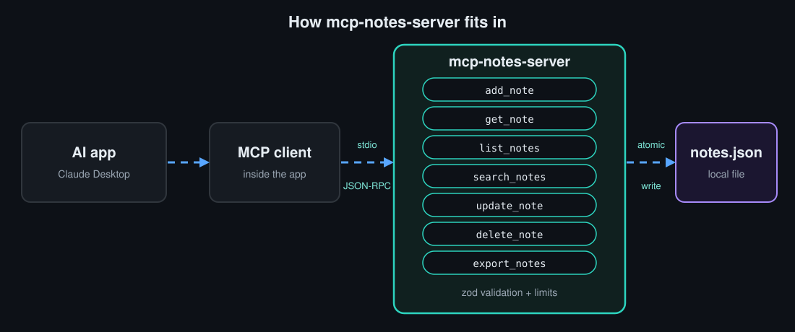
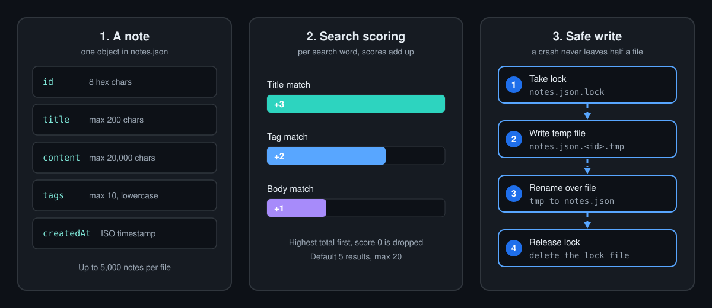

<div align="center">

# mcp-notes-server

**An MCP server that gives Claude and other AI assistants a searchable notes memory, stored in one local JSON file.**

[](https://github.com/techsaurabh-394/mcp-notes-server/actions/workflows/ci.yml)
[](LICENSE)
[](https://www.npmjs.com/package/mcp-notes-server)
[](https://github.com/techsaurabh-394/mcp-notes-server/stargazers)
[](package.json)

[](https://m8ven.ai/mcp/techsaurabh-394-mcp-notes-server-1v0wwu?s=readme)

</div>

`mcp-notes-server` is a [Model Context Protocol](https://modelcontextprotocol.io) (MCP) server written in TypeScript. Connect it to Claude Desktop, Claude Code or any MCP client and your AI assistant can save, search, edit, export and delete notes that survive between chats: simple AI assistant memory you own, on your disk, with no cloud and no network calls.



## Quick start (60 seconds)

You need Node.js 18 or newer.

```bash
# Claude Code
claude mcp add notes -- npx -y mcp-notes-server
```

For **Claude Desktop**, add this to `claude_desktop_config.json` (Settings, Developer, Edit Config), then fully quit and restart the app:

```json
{
  "mcpServers": {
    "notes": {
      "command": "npx",
      "args": ["-y", "mcp-notes-server"]
    }
  }
}
```

Then type: *"Save a note titled RAG chunking: use 800-character chunks. Tag it rag."* and *"Search my notes for chunking."*

Prefer a clone? `git clone https://github.com/techsaurabh-394/mcp-notes-server && cd mcp-notes-server && npm install && npm run build`, then use `"command": "node"` with `"args": ["/absolute/path/to/mcp-notes-server/dist/index.js"]` (print it with `echo "$(pwd)/dist/index.js"`). Relative paths fail because the app starts the server from another folder.

## Tools

| Tool | What it does | Inputs | Side effects |
|---|---|---|---|
| `add_note` | Save a new note, returns its id | `title` (1-200 chars), `content` (1-20,000), `tags?` (max 10, each max 50) | Writes the notes file |
| `get_note` | Fetch one note with full content | `id` | None (read-only) |
| `list_notes` | List notes newest first, titles and tags only | `tag?` | None (read-only) |
| `search_notes` | Keyword search over titles, tags and bodies | `query`, `limit?` (1-20, default 5) | None (read-only) |
| `update_note` | Edit title, content and/or tags (tags replace the old ones) | `id`, plus at least one of `title`, `content`, `tags` | Rewrites the notes file |
| `delete_note` | Permanently delete one note | `id` | Rewrites the notes file. Marked `destructiveHint` |
| `export_notes` | Return all notes (or one tag) as one Markdown document | `tag?` | None (read-only, nothing is written to disk) |
| `list_tags` | List every tag in use with its note count, most used first | None | None (read-only) |

The server also exposes the resources `notes://all` and `notes://{id}`, and a `review_notes` prompt that asks the model to summarise and tidy your notes.

Every tool has a typed `zod` input schema and MCP tool annotations (`readOnlyHint`, `destructiveHint`, `idempotentHint`, `openWorldHint`), so clients can show the right confirmation UI. Invalid input returns a clear error and stores nothing.

## Example prompts

1. "Save a note titled *Docker tips*: use multi-stage builds to keep images small. Tag it docker and devops."
2. "Search my notes for docker and summarise what I wrote."
3. "Change the tags on that note to docker, images."
4. "List everything tagged devops, then export those notes as Markdown."
5. "Delete the note about Docker tips."

## How it works



1. Your AI app starts the server as a child process and talks to it over **stdio** using JSON-RPC.
2. The model reads the tool list and picks a tool.
3. The server validates the input with `zod` and the store's own limits.
4. Writers take a lock file, write a temp file, then **rename** it over `notes.json`. A crash never leaves half a file.
5. The result goes back to the model as text.



**Storage.** One JSON file: `~/.mcp-notes/notes.json`, or the path in the `NOTES_FILE` environment variable. Each note has `id` (8 hex characters), `title`, `content`, `tags` (lowercased, de-duplicated) and `createdAt` (ISO timestamp).

**Search.** For each search word: +3 if it is in the title, +2 if it matches a tag exactly, +1 if it is in the body. Scores add up, highest first, zero scores are dropped. It is plain keyword matching, not semantic search.

**Limits.** Title 200 characters with no line breaks, content 20,000 characters, 10 tags of at most 50 characters each, 5,000 notes per file. A notes file with malformed entries is refused rather than overwritten.

**Two clients at once.** Writes hold an exclusive lock file (`notes.json.lock`) for the read-modify-write cycle. A lock older than 30 seconds is treated as left behind by a crash and removed. A test starts four separate OS processes that add 15 notes each and checks all 60 survive.

## Optional: human approval before delete

By default `delete_note` runs immediately. To require approval, install [mcp-safe-actions](https://github.com/techsaurabh-394/mcp-safe-actions) next to the server and set `NOTES_CONFIRM_DELETE=1`:

```bash
npm install github:techsaurabh-394/mcp-safe-actions   # in the folder that holds mcp-notes-server
```

```json
{
  "mcpServers": {
    "notes": {
      "command": "node",
      "args": ["/absolute/path/to/mcp-notes-server/dist/index.js"],
      "env": { "NOTES_CONFIRM_DELETE": "1" }
    }
  }
}
```

`delete_note` then uses `registerConfirmedTool`: clients that support MCP elicitation ask you directly; others get a one-time token the model must pass back. Nothing is deleted before approval. Extra variables: `NOTES_CONFIRM_MODE` (`auto`, `elicit` or `token`) and `NOTES_AUDIT_FILE` (path for a JSON-lines audit log). If the package is missing, the server refuses to start instead of silently running unguarded. mcp-safe-actions is not on npm yet, so it is installed from GitHub.

## Security notes

- No shell, no SQL, no network calls: the server only reads and writes one JSON file.
- The file path comes from the operator (`NOTES_FILE`), never from tool input. Ids are never used as paths, and `get_note`/`update_note`/`notes://{id}` reject ids that are not 8 hex characters.
- stdout is the protocol channel. All logging goes to stderr (a test checks every stdout line is a JSON-RPC message).
- Not covered: notes are plain text with no encryption or access control beyond your operating system's file permissions. Anything in a note is visible to the AI model that reads it, so do not store secrets in notes. Do not point several machines at one file over a network share: the lock file is only safe on a local filesystem.
- Report vulnerabilities as described in [SECURITY.md](SECURITY.md).

## Development and tests

```bash
npm install
npm run lint        # tsc --noEmit
npm test            # build, then node:test
npm run coverage    # same, with Node's built-in coverage report
```

The suite has store unit tests (limits, locking, stale locks, export) and end-to-end tests that spawn the built server over stdio with the MCP SDK client and call every tool with valid input, invalid input, empty results and unknown ids. CI runs on Node 18, 20 and 22 and prints the coverage table to the job summary. See [CONTRIBUTING.md](CONTRIBUTING.md) and [CHANGELOG.md](CHANGELOG.md).

## Roadmap

- [x] Typed tools, resources and a prompt
- [x] Input limits, lock-file safe writes, Markdown export
- [x] Optional human approval for delete
- [x] Publish to npm
- [ ] Optional SQLite backend for large collections
- [ ] Semantic search with embeddings
- [ ] Streamable HTTP transport for remote clients
- [ ] Import from Markdown

## FAQ

**Where are my notes?** In `~/.mcp-notes/notes.json`, or at your `NOTES_FILE` path. Changing `NOTES_FILE` shows a different, empty set of notes.

**Does it send my notes anywhere?** The server makes no network calls. But your AI app sends the notes it reads to its model provider as part of the conversation.

**Does it work with clients other than Claude Desktop?** It speaks standard MCP over stdio, so Claude Code, Cursor and other MCP clients can run it. Only Claude Desktop and Claude Code are documented here.

**The server does not show up.** Run `node dist/index.js` yourself: it should print `mcp-notes-server running on stdio` to stderr. Check that the config JSON is valid, the path is absolute, and you fully restarted the app. If the app cannot find `node`, put the full path from `which node` in `"command"`.

**Is search semantic?** No. It is keyword scoring over titles, tags and bodies.

**Can I back up my notes?** Copy the JSON file, or ask the assistant to run `export_notes` and save the Markdown.

## Contributing

Small, focused pull requests are welcome. Read [CONTRIBUTING.md](CONTRIBUTING.md), and look for issues labelled **good first issue**. Please follow the [Code of Conduct](CODE_OF_CONDUCT.md).

## Support this project

If this saves you time, a star helps others find it, and you can support more free open-source work:

<a href="https://buymeacoffee.com/saurabhdev"></a>

## Author

**Saurabh Pathak**, AI engineer and full-stack developer.

[GitHub](https://github.com/techsaurabh-394) · [LinkedIn](https://www.linkedin.com/in/tech-saurabh/) · [Blog: mernstackdev.com](https://mernstackdev.com)

## License

[MIT](LICENSE)
