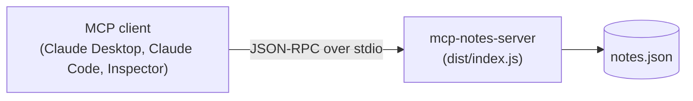

# mcp-notes-server

[](https://github.com/techsaurabh-394/mcp-notes-server/stargazers) [](LICENSE) [](https://github.com/techsaurabh-394/mcp-notes-server/commits/main) [](https://github.com/techsaurabh-394/mcp-notes-server/issues) [](https://buymeacoffee.com/saurabhdev)

A complete reference [Model Context Protocol](https://modelcontextprotocol.io) (MCP) server in TypeScript: **6 tools, resources and a prompt**, backed by a persistent, searchable notes file. Small enough to read in one sitting, and tested end to end over real stdio.

## What is MCP?

The Model Context Protocol is an open standard that lets AI apps (like Claude) talk to outside programs in one uniform way, a bit like USB-C for AI. Instead of custom glue for every assistant, you write one *MCP server* that offers **tools** (actions the AI can run), **resources** (data it can read) and **prompts** (reusable templates), and any MCP client can discover and use them.

**Learn MCP step by step:** [ai-engineer-roadmap / 06-mcp](https://github.com/techsaurabh-394/ai-engineer-roadmap/tree/main/06-mcp)

## Architecture



<!-- Add a demo GIF here after recording one:   -->

## Tools

| Tool | What it does | Hints |
|---|---|---|
| `add_note` | Save a note with title, content and optional tags | Writes |
| `get_note` | Fetch one note by id | Read-only |
| `list_notes` | List notes newest first, optionally by tag | Read-only |
| `search_notes` | Keyword search over titles, tags and bodies (title matches rank highest) | Read-only |
| `update_note` | Edit title, content and/or tags (tags replace existing ones) | Writes, idempotent |
| `delete_note` | Permanently delete a note by id | Destructive |

Errors (unknown id, malformed id, empty update) come back as `isError` results with a clear message, never as crashes.

## Resources and prompts

| Type | Name / URI | Description |
|---|---|---|
| Resource | `notes://all` | Every note, newest first, as plain text |
| Resource template | `notes://{id}` | One note by id; each note is also listed individually |
| Prompt | `review_notes` (optional `tag`) | Asks the model to summarise your notes, flag duplicates and suggest better tags |

Notes are stored in a JSON file (`~/.mcp-notes/notes.json` by default, override with `NOTES_FILE`). Writes are atomic (temp file + rename).

## Quick start

```bash
git clone https://github.com/techsaurabh-394/mcp-notes-server.git
cd mcp-notes-server
npm install
npm run build
npm test
```

## Use with Claude Desktop

Add this to your Claude Desktop config (`claude_desktop_config.json`), using the absolute path to your clone:

```json
{
  "mcpServers": {
    "notes": {
      "command": "node",
      "args": ["/absolute/path/to/mcp-notes-server/dist/index.js"],
      "env": { "NOTES_FILE": "/absolute/path/to/notes.json" }
    }
  }
}
```

Restart Claude Desktop, then try:

- "Save a note titled *RAG chunking* with the content *use 800-char chunks with overlap*, tag it rag."
- "Search my notes for chunking."
- "Change the tags on that note to rag and search."

## Use with Claude Code

```bash
claude mcp add notes -- node /absolute/path/to/mcp-notes-server/dist/index.js
# optional: custom storage file
claude mcp add notes --env NOTES_FILE=/absolute/path/to/notes.json -- node /absolute/path/to/mcp-notes-server/dist/index.js
```

Run `claude mcp list` to confirm. Other MCP clients (Cursor, etc.) work the same way: point them at `node dist/index.js` over stdio.

## Test with the MCP Inspector

```bash
npm run build
npx @modelcontextprotocol/inspector node dist/index.js
```

Open the printed URL to browse and call the tools, resources and prompt interactively.

## Testing

`npm test` builds and runs the `node:test` suite: store unit tests plus an end-to-end test that spawns the built server over stdio with the SDK client and exercises initialize, every tool, resources and prompts. CI runs it on Node 22.

## Security design

- **No shell, no SQL, no network:** the server only reads and writes one JSON file.
- **Path handling:** the file path comes from the operator (`NOTES_FILE`), never from tool input. Note ids are validated (`^[a-f0-9]{8}$`) and only compared against stored ids, never used as paths.
- **stdout is the protocol channel:** all logging goes to stderr.
- **Validation:** every tool input is checked with `zod` (length and count limits); bad input returns an error result.
- **Annotations:** read-only tools are marked `readOnlyHint`, `delete_note` is `destructiveHint`, so clients can show the right confirmation UI.
- **Atomic writes** avoid a half-written notes file.

## Project layout

```
src/index.ts             MCP server: tools, resources, prompt
src/store.ts             NoteStore: JSON-file persistence and search
src/test/store.test.ts   unit tests
src/test/e2e.test.ts     end-to-end test over stdio
.github/workflows/ci.yml GitHub Actions CI
```

## License

MIT, built by Saurabh Pathak.

## Roadmap (contributions welcome)
- [x] `update_note` tool (edit title, content, tags)
- [x] Resources (`notes://all`, `notes://{id}`) and a `review_notes` prompt
- [ ] Optional SQLite backend for large note collections
- [ ] Semantic search using embeddings
- [ ] Publish to npm so it runs with `npx mcp-notes-server`
- [ ] Streamable HTTP transport for remote clients

If this is useful, a star helps others find it.

## Support this project
If this is useful, a star helps others find it, and you can support more free open-source work:

<a href="https://buymeacoffee.com/saurabhdev"></a>

---

<p align="center">
  <b>Saurabh Pathak</b> · AI Engineer &amp; Full-Stack Developer<br/>
  <a href="https://github.com/techsaurabh-394">GitHub</a> ·
  <a href="https://www.linkedin.com/in/tech-saurabh/">LinkedIn</a> ·
  <a href="https://mernstackdev.com">Blog</a> ·
  <a href="mailto:saurabhpathak394@gmail.com">saurabhpathak394@gmail.com</a>
</p>
